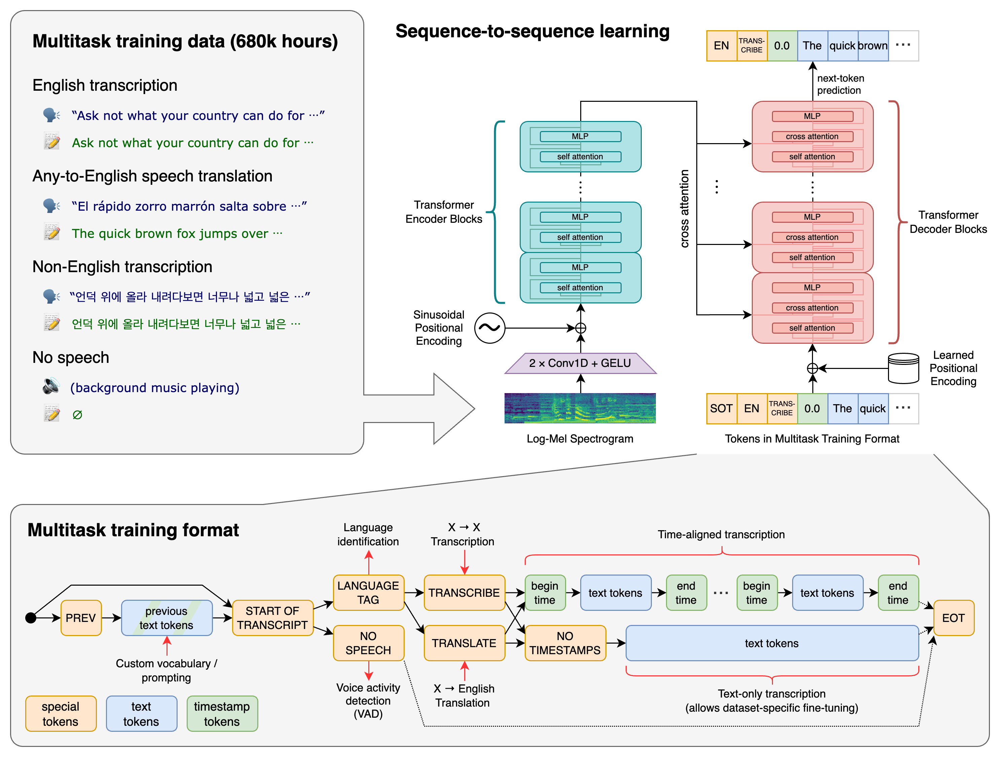
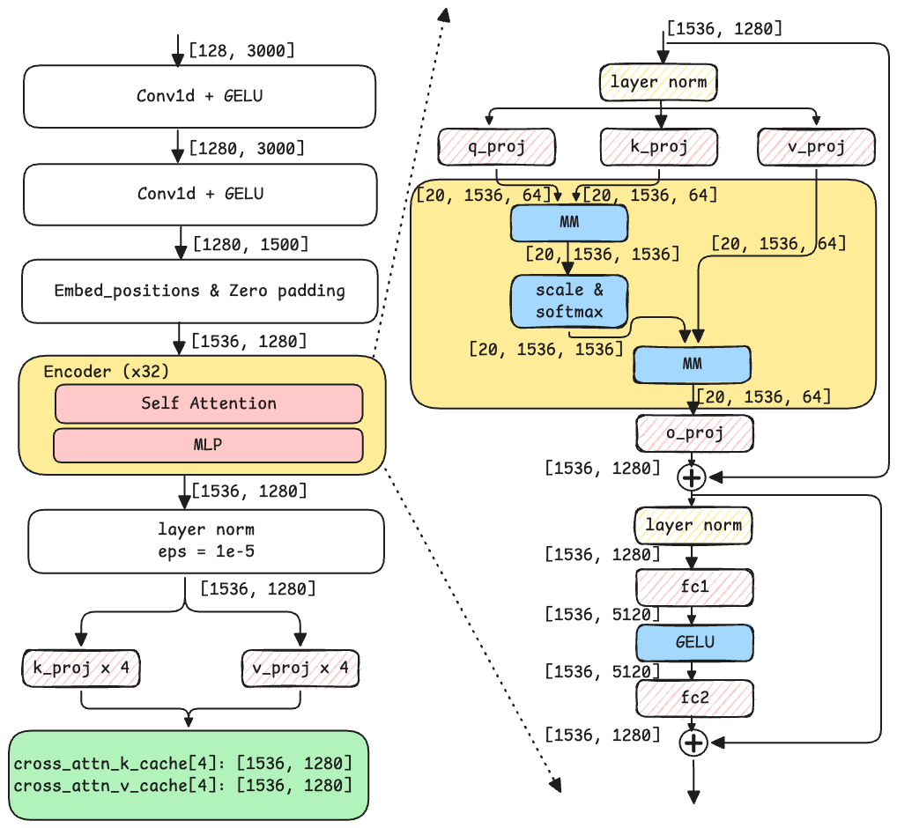

<!--
  Copyright © Advanced Micro Devices, Inc., or its affiliates. All rights reserved.
  Portions of this file consist of AI-generated content.
-->

# Whisper on NPU

This project implements OpenAI whisper speech-to-text (Turbo v3) on AMD RyzenAI NPU. [Whisper (official repository)](https://github.com/openai/whisper)

## Whisper Turbo v3 Architecture

  

  <em>Figure 1: Whisper Turbo v3 Architecture</em> 
  Figure: Copyright (c) 2022 OpenAI. Reproduced from
  <a href="https://github.com/openai/whisper/blob/main/approach.png">openai/whisper</a> under the MIT License
  (see <a href="Figures/LICENSE.openai-whisper">Figures/LICENSE.openai-whisper</a>).

- **Audio preprocessing (CPU)**  
  Log-mel spectrogram extraction from 16 kHz audio input

- **Encoder execution (NPU)**  
  Transformer encoder applied once per audio segment

- **Decoder autoregressive loop (NPU)**  
  Token-by-token decoding with self-attention KV cache

While audio preprocessing and token handling remain on the CPU, this project focuses on the **encoder and decoder**, which are mapped to the AMD Ryzen AI NPU and form the core of the Whisper inference workload.

## Encoder execution pipeline

This section describes the encoder execution pipeline of Whisper Turbo v3, with an emphasis on how computation is partitioned between CPU and NPU.

<table>
<tr>
<td width="55%" valign="top">

- The encoder consists of **32 layers**.
- Input shape: **(128, 3000)** (log-mel spectrogram).
- Output shape: **(1500, 1280)**, zero-padded to **(1536, 1280)** for alignment.

Operations are partitioned as follows:

- **NPU**
  - Conv1D front end (both convs run as matmuls, see below)
  - Matrix multiplications (QKV, output, FFN, cross-attention K/V)
  - Self-attention with non-causal mask
  - Weight dequantisation (once; the bf16 weights are then cached)

- **CPU**
  - Positional embedding, layer normalization, bias additions, GELU, residual stream (fp32)

</td>
<td width="45%" align="center">

<em>Figure 2: Encoder architecture.</em>

</td>
</tr>
</table>

### Kernels

All five kernels build with Peano by default (`make bitstream`); `ENABLE_CHESSCC=1` selects chess.

| xclbin (`Whisper-V3-Turbo-NPU2/`) | folder | what |
|---|---|---|
| `encoder_mm.xclbin` | `encoder_MM` | bf16 matmul, 4 x 8 cores, tile m 96 x k 256 x n 64 |
| `encoder_attn.xclbin` | `encoder_attention_888` | non-causal attention, 8x8x8 mmul (`encoder_attention_884` is the older 8x8x4 variant, not shipped) |
| `encoder_dequant.xclbin` | `encoder_dequant` | q4 -> bf16 weight dequantisation |
| `decoder_mv.xclbin` | `decoder_mv_dequant_mv` | decoder matrix-vector products (bf16 and q4) |
| `whisper_head.xclbin` | `whisper_lm_head_npu_bin` | q4 LM head |

Contract between kernels and engine (`FLM_DLL/detail/whisper_npu`), keep both sides in sync:

- **RTP addresses are pinned** in the IRON designs and written there by the engine: encoder MM `K_div_k` and
  attention `L` at 61440, decoder `M_div_m` / `K_div_k` at 61440 / 62464. The engine and the xclbins therefore
  ship together. `--alloc-scheme basic-sequential` keeps the pins exact (the bank-aware allocator fails on these
  designs and its fallback moved a pinned buffer).
- **Attention RTP** (`L` buffer): slot 0 query rows, slot 1 number of 512-key chunks, slot 2 keys that are not
  padding (1500); keys past slot 2 get no weight.
- **MM weight layout** (what the dequant kernel writes and what the conv front end packs, `mm_w_index`):
  64-row blocks, 256-wide K chunks inside a block, and inside a chunk `[n / 8][k % 8][k / 8][n % 8]`.

Peano notes: ping/pong flags live in `.data` and are volatile (`.bss` is not zeroed, and a lock acquire is not a
memory barrier), RTP pointers are volatile, cores get 4 KiB stacks, and `aie::vector::extract<N>(i)` with a
runtime index is avoided (Peano returned the wrong slice in `qmm.cc` / `mv_dequant.cc`).

### Performance

Encoder time per 30 s window, Strix Halo (Ryzen AI MAX+ 395), `WHISPER_PROFILE=1` gives the per-stage split:

| | ms / window |
|---|---|
| before (884 attention, chess, CPU conv, weights dequantised every window) | ~1650-1950 |
| now | ~590-605 |

What made the difference:

- **Attention (888 kernel):** 8x8x8 mmul, score tiles kept in the mmul block layout from QK^T to P*V, row max
  once per 512-key chunk, softmax on two rows per vector, q scaled by 1/8 once. 559 -> 205 ms per window
  (of which ~85 ms is the xclbin switch into the attention).
- **Weight cache:** the dequantised bf16 weights stay in device memory (+1.25 GB, `WHISPER_CACHE_DEQUANT=0`
  turns it off), which also removes two xclbin switches per layer.
- **Engine:** k/v projections write straight into the attention's K/V buffer; the V bias is folded into the
  output-projection bias (softmax rows sum to 1); fused bias/residual/GELU passes; o-proj, fc1 and fc2 run on
  two row halves so the CPU part of one half overlaps the NPU matmul of the other.
- **Conv front end on the NPU:** both convs are matmuls over overlapping rows of the input (the x row stride is
  one frame for conv1 and two frames for conv2), so no im2col copy is needed.
- **MM kernel (Peano):** each bf16 operand is converted to bfp16 once per 8x8 block instead of once per mac.

Remaining large cost: two xclbin switches (matmul <-> attention) per layer, ~2.65 ms each, ~170 ms per window.
