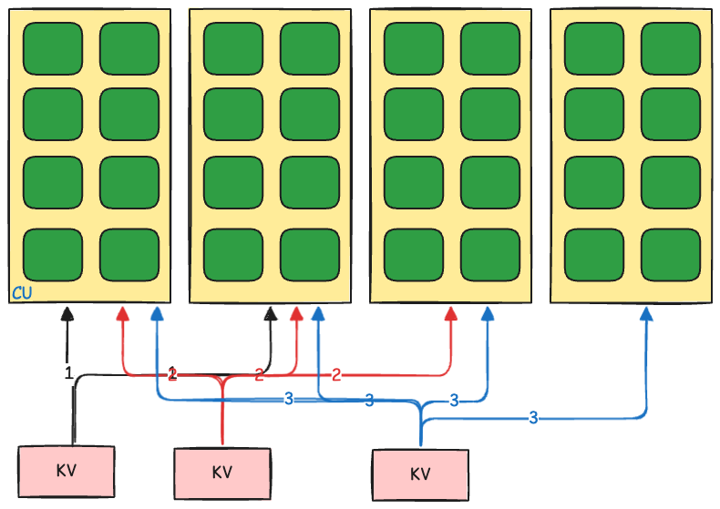

<!--
  Copyright © Advanced Micro Devices, Inc., or its affiliates. All rights reserved.
-->

# Prefill Attention Machine

This project implements a **prefill attention engine** for large language models, designed to support **multiple head dimensions (dh)** and **different Grouped Query Attention (GQA) configurations**.  

---

## Overview

During the prefill phase, attention is computed over the full input sequence.
This project provides a unified attention implementation that supports:

- Multiple **head dimensions (dh)**
- Multiple **GQA ratios**
- Both **causal mask** and **sliding window mask** using a **shared kernel implementation**

---

## Attention Masks

### Unified Masking Design

Both **causal attention** and **sliding window attention** are implemented using the **same kernel**, with masking behavior controlled by runtime parameters.

- **Causal mask**
  - Enforces autoregressive attention
  - Standard lower-triangular masking

- **Sliding window mask**
  - Limits attention to a fixed window size

---

## Two Prefill Attention Dataflow Design

Common assumptions across both dataflows:

- Each **CU processes a different attention head**
- **KV sharing follows the model-specific GQA configuration**

---
### Dataflow 1: 128 × 128 Score Block Processing
<table>
<tr>
<td width="55%" valign="top">

This dataflow uses finer-grained tiling for the prefill attention stage.

- Each CU has two columns of CTs
- Each CU processes a different attention head
- KV sharing follows model-specific GQA
- Computes a 128 × 128 block of the score matrix per step

</td>
<td width="45%" align="center">

<em>Figure 1: Prefill attention dataflow with 128 × 128 blocks.</em>

</td>
</tr>
</table>

#### Head Dimension and GQA Support

The attention engine supports the following combinations of head dimension (`dh`) and GQA ratio:

| dh  | GQA 1:2 | GQA 1:3 | GQA 1:4 |
|-----|--------:|--------:|--------:|
| 64  |         |         | ✅      |
| 128 | ✅      | ✅      | ✅      |
| 256 | ✅      |         | ✅      |

- **dh**: attention head dimension  
- **GQA 1:N**: number of query heads to key/value heads ratio

---

#### Limitations

- **Sequence length alignment requirement**  
  To satisfy kernel alignment, the input sequence
  length must be zero-padded as follows:
  - For **dh = 128** and **dh = 256**, the sequence length must be padded to a **multiple of 128**
  - For **dh = 64**, the sequence length must be padded to a **multiple of 256**

  Padding is applied only for alignment purposes and does not affect the correctness of
  the attention computation.

#### Code Location

The core attention is implemented in:

- [`attention_DH_64_GQA_1_4`](attention_DH_64_GQA_1_4)
- [`attention_DH_128_GQA_1_2`](attention_DH_128_GQA_1_2)
- [`attention_DH_128_GQA_1_3`](attention_DH_128_GQA_1_3)
- [`attention_DH_128_GQA_1_4`](attention_DH_128_GQA_1_4)
- [`attention_DH_256_GQA_1_2`](attention_DH_256_GQA_1_2)
- [`attention_DH_256_GQA_1_4`](attention_DH_256_GQA_1_4)

#### Execution Time (ms)

| Seq Len | dh=64, GQA=1:4 | dh=128, GQA=1:2 | dh=128, GQA=1:3 | dh=128, GQA=1:4 | dh=256, GQA=1:2 | dh=256, GQA=1:2 | dh=256, GQA=1:4 |dh=256, GQA=1:4 |
|--------:|---------------:|-----------------:|-----------------:|-----------------:|-----------------:|-----------------:|-----------------:|-----------------:|
| Heads   | 32Q / 8KV      | 16Q / 8KV        |24Q / 8KV         | 32Q / 8KV        |  8Q / 4KV        |  Sliding window (1024)      | 4Q / 1KV      |Sliding window (512) |
| 1024    | 2.1            |  1.5             | 2.3             |  2.96               |  1.3                |1.2                  | 0.7             |0.6 |
| 2048    | 6.5            |  5.1             | 7.8             |  9.9                |  4.2                |3.4                  | 2.4             |1.2 |
| 4096    | 23.1           |  19.1            | 28.1            |  37.2                | 15.8               |8.1                  | 8.5              |2.5 |
| 8192    | 86.1           |  71.5            | 106.6            | 142                 | 59                |17.2                  | 30.6               |5.1| 
| 16384   | 337.3          | 278.9            | 417.8            | 556.7                 |229.4          |35.2                  |  115.8                |10.2 |

---

